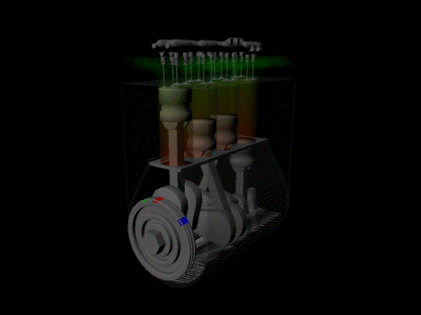
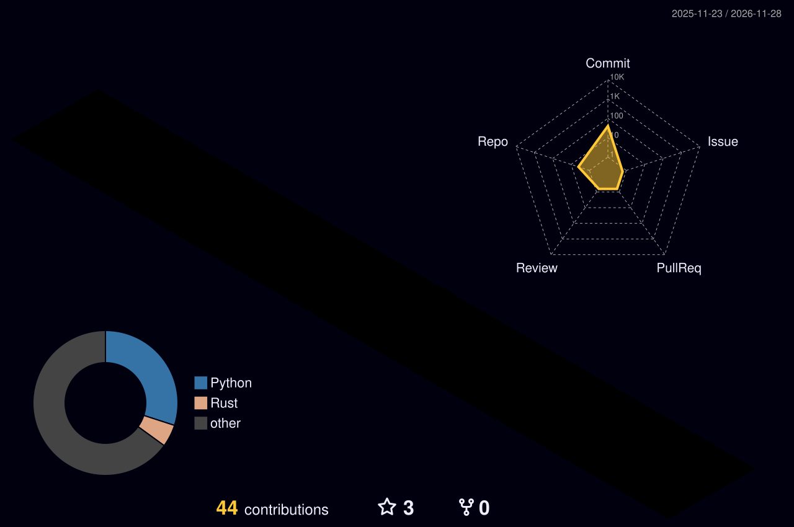

  

<h1 align="center">
  
  Привет, я Данил (DIAVOLIII)
  
</h1>

 

  

 

  
<strong>[-] Цель:</strong> Стать универсальным разработчиком с пониманием low-level и high-level парадигм.

  
<strong>[+] Изучаю:</strong> Алгоритмы, архитектуру ПО, машинное обучение и системное программирование.

  
<strong>[>] Работа:</strong> Работаю над личной операционной системой на Android Studio + разработал полный шаблон ОС под Android.

  
<strong>[#] Колледж:</strong> Студент IT-Колледжа MAXITET.

 

  

 

  

 

<strong>GitHub Статистика</strong>

 

    
    

 

<h3 align="center" style="font-size: 24px;">Технологии и инструменты</h3>

  <table align="center" style="border-collapse: collapse; width: 100%; max-width: 900px; background-color: #0d1117; border: 1px solid #30363d;">
    <tr>
      <td align="center" style="padding: 20px; border: 1px solid #30363d;"></td>
      <td align="center" style="padding: 20px; border: 1px solid #30363d;"></td>
      <td align="center" style="padding: 20px; border: 1px solid #30363d;"></td>
      <td align="center" style="padding: 20px; border: 1px solid #30363d;"></td>
      <td align="center" style="padding: 20px; border: 1px solid #30363d;"></td>
    </tr>
    <tr>
      <td align="center" style="padding: 20px; border: 1px solid #30363d;"></td>
      <td align="center" style="padding: 20px; border: 1px solid #30363d;"></td>
      <td align="center" style="padding: 20px; border: 1px solid #30363d;"></td>
      <td align="center" style="padding: 20px; border: 1px solid #30363d;"></td>
      <td align="center" style="padding: 20px; border: 1px solid #30363d;"></td>
    </tr>
    <tr>
      <td align="center" style="padding: 20px; border: 1px solid #30363d;"></td>
      <td align="center" style="padding: 20px; border: 1px solid #30363d;"></td>
      <td align="center" style="padding: 20px; border: 1px solid #30363d;"></td>
      <td align="center" style="padding: 20px; border: 1px solid #30363d;"></td>
      <td align="center" style="padding: 20px; border: 1px solid #30363d;"></td>
    </tr>
    <tr>
      <td align="center" style="padding: 20px; border: 1px solid #30363d;"></td>
      <td align="center" style="padding: 20px; border: 1px solid #30363d;"></td>
      <td align="center" style="padding: 20px; border: 1px solid #30363d;"></td>
      <td align="center" style="padding: 20px; border: 1px solid #30363d;"></td>
      <td align="center" style="padding: 20px; border: 1px solid #30363d;"></td>
    </tr>
  </table>

    
    
    
    
    
    
    
    

 

<h3 align="center" style="font-size: 24px;">Достижения и сертификаты</h3>

<table align="center" style="width: 100%; max-width: 800px; font-size: 18px; border-collapse: collapse;">
  <tr style="background-color: #161b22; color: #c9d1d9;">
    <th style="padding: 15px; border: 1px solid #30363d;">Курс</th>
    <th style="padding: 15px; border: 1px solid #30363d;">Организация</th>
    <th style="padding: 15px; border: 1px solid #30363d;">Дата начала</th>
    <th style="padding: 15px; border: 1px solid #30363d;">Дата окончания</th>
  </tr>
  <tr>
    <td style="padding: 15px; border: 1px solid #30363d;">Python (базовый/продвинутый)</td>
    <td style="padding: 15px; border: 1px solid #30363d;">Код будущего</td>
    <td style="padding: 15px; border: 1px solid #30363d;">23.04.2024</td>
    <td style="padding: 15px; border: 1px solid #30363d;">01.06.2024</td>
  </tr>
  <tr>
    <td style="padding: 15px; border: 1px solid #30363d;">The Rust Programming Language</td>
    <td style="padding: 15px; border: 1px solid #30363d;">Rust Foundation</td>
    <td style="padding: 15px; border: 1px solid #30363d;">20.06.2024</td>
    <td style="padding: 15px; border: 1px solid #30363d;">02.09.2024</td>
  </tr>
  <tr>
    <td style="padding: 15px; border: 1px solid #30363d;">C++</td>
    <td style="padding: 15px; border: 1px solid #30363d;">C++ Курс "Разработчик С++"</td>
    <td style="padding: 15px; border: 1px solid #30363d;">06.03.2024</td>
    <td style="padding: 15px; border: 1px solid #30363d;">01.06.2024</td>
  </tr>
  <tr>
    <td style="padding: 15px; border: 1px solid #30363d;">ML</td>
    <td style="padding: 15px; border: 1px solid #30363d;">Онлайн-курс Machine Learning Engineer</td>
    <td style="padding: 15px; border: 1px solid #30363d;">25.04.2025</td>
    <td style="padding: 15px; border: 1px solid #30363d;">02.06.2025</td>
  </tr>
</table>

 

<h3 align="center" style="font-size: 24px;">Codewars</h3>

  

 

  

 

  

 

<h4 align="center">
<pre style="font-size: 16px;">
+@ @ @ @ @ @ @ @ @ @ @ @ @ @ @ @ @ @ @ @ @ @ @ @ @ @ @ @+
@@       o o                                           @@
@@       | |                                           @@
@@      _L_L_                                          @@
@@   ❮\/__-__\/❯ Programming isn't about what you know @@
@@   ❮(|~o.o~|)❯  It's about what you can figure out   @@
@@   ❮/ \`-'/ \❯                                       @@
@@     _/`U'\_                                         @@
@@    ( .   . )     .----------------------------.     @@
@@   / /     \ \    | while( ! (succeed=try() ) ) |     @@
@@   \ |  ,  | /    '----------------------------'     @@
@@    \|=====|/                                        @@
@@     |_.^._|                                         @@
@@     | |"| |                                         @@
@@     ( ) ( )   Testing leads to failure              @@
@@     |_| |_|   and failure leads to understanding    @@
@@ _.-' _j L_ '-._                                     @@
@@(___.'     '.___)                                    @@
+@ @ @ @ @ @ @ @ @ @ @ @ @ @ @ @ @ @ @ @ @ @ @ @ @ @ @ @+
</pre>
</h4>

 

<h3 align="center" style="font-size: 24px;">Minesweeper</h3>

Играй прямо в README. Кликни по ссылке, создай Issue без изменений — поле обновится.

  

 

  

 

<h1 align="center" style="font-size: 28px;">Связаться со мной</h1>

  
  
  

 

  

  

